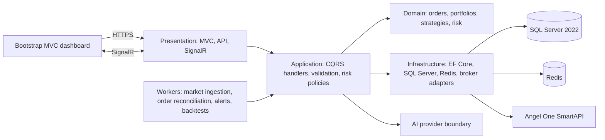
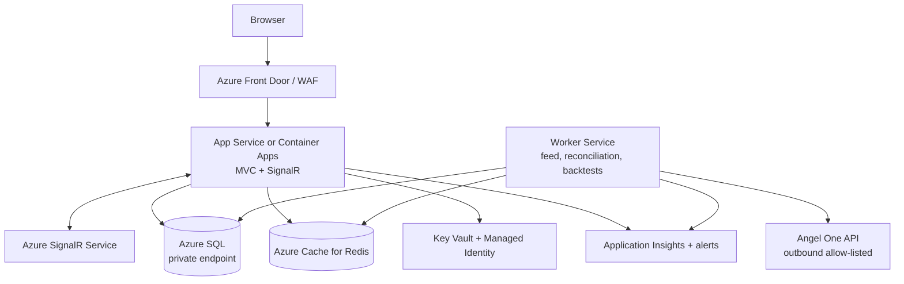

# Trading Desk — phased platform starter

This repository is currently a runnable .NET 10 MVC **paper-trading prototype**, not a production brokerage platform. The dashboard's market stream and fills are simulated, account state is session-scoped in-process memory, and it has no authentication or broker connectivity. Each browser session gets an isolated virtual account; it expires after 30 minutes idle or when the process restarts. Never use these prices or fills for investment decisions.

## Run

Open `tradingbot.slnx` in Visual Studio 2026 or run `dotnet run --project tradingbot\tradingbot.csproj`. Each browser session starts with ₹10,00,000 virtual cash. The demo feed emits clearly labeled simulated quote updates over SignalR every two seconds.

The paper order endpoint accepts market buy/sell only. It enforces positive quantity, a ₹2,00,000 buy-entry notional cap, available cash, long-only holdings, and a ₹20,000 session loss gate for new entries; reducing/closing an existing position remains allowed. This is a prototype risk guard—not a substitute for broker-side controls or regulatory compliance.

## Current implementation

- ASP.NET Core MVC dashboard with responsive dark trading-desk layout.
- Simulated market feed and `MarketHub` SignalR broadcast at `/hubs/market`; quote snapshot at `GET /api/market/quotes`.
- Session-scoped in-memory paper account and atomic order/position/P&L updates through `IPaperTradingService`.
- SQL Server 2022 logical schema in `Database/schema.sql` for future persistence. It is a design artifact and is not wired to EF Core yet.

## Target architecture



Keep broker APIs and AI behind interfaces in Infrastructure; domain/application code must not depend on either provider. Production order placement requires idempotency keys, durable order state, reconciliation, user consent, audit events, secret rotation, and a kill switch. Never send broker credentials to the browser or store them unencrypted.

## Logical data model

```mermaid
erDiagram
  Users ||--o{ Portfolios : owns
  Users ||--o{ Strategies : authors
  Users ||--o{ Indicators : defines
  Portfolios ||--o{ Orders : contains
  Portfolios ||--o{ Trades : records
  Portfolios ||--o{ Positions : tracks
  Portfolios ||--o{ PaperOrders : simulates
  PaperOrders ||--o{ PaperTrades : fills
  Portfolios ||--|| RiskSettings : governs
  Strategies ||--o{ Signals : emits
  Strategies ||--o{ Backtests : evaluates
  Users ||--o{ Watchlists : saves
  Users ||--o{ AIAnalysis : requests
  Users ||--o{ AuditLogs : acts
 ```

The executable SQL Server DDL and constraints/indexes are in `Database/schema.sql`. It includes users/roles/permissions, portfolios/risk settings, strategies/indicators, real and paper orders/trades, positions, market data/options, signals, news, AI analysis, backtests, watchlists, and audit records. Review and version the DDL through EF migrations before production rollout; enforce tenant ownership in every query.

## MVC and service structure

```text
tradingbot/
  Controllers/     HomeController, PaperTradingController, MarketController
  Hubs/            MarketHub
  Models/          TradingModels, ErrorViewModel
  Services/        IMarketFeed, IPaperTradingService, simulated implementations
  ViewModels/      DashboardViewModel
  Views/           Home/Index, Shared/_Layout
  Database/        schema.sql
  wwwroot/         dashboard styles and SignalR client
```

The prototype uses service interfaces and constructor injection. The next persistence slice should add Domain/Application/Infrastructure projects, EF Core repositories, CQRS handlers and a SQL-backed unit of work. Keep broker and market-data adapters separate from paper-trading execution.

## UX wireframe

```text
┌ Sidebar / workspace ──┬ Top bar: PAPER mode · simulated feed · account ─────┐
│ Overview              │ NIFTY · BANK NIFTY · SENSEX · FIN NIFTY quote strip │
│ Market watch          ├─────────────────────────────────────────────────────┤
│ Paper terminal        │ Equity / day P&L / cash / open positions metrics    │
│ Strategies            ├────────────────────────────────┬────────────────────┤
│ Backtests             │ Instrument chart + positions   │ Buy / sell ticket  │
│ Analytics             ├────────────────────────────────┴────────────────────┤
│ Settings              │ Recent paper orders · risk guard                   │
└───────────────────────┴─────────────────────────────────────────────────────┘
```

Mobile collapses the sidebar and stacks the quote strip, chart, order ticket, and tables. In the production UI, add keyboard-accessible order entry, explicit confirmation for live orders, market-data freshness, and clear stale/disconnected states.

## Current code paths and contracts

- `POST /PaperTrading/PlaceOrder` is antiforgery protected and executes only through `IPaperTradingService`; user input never selects a broker.
- `GET /api/market/quotes` returns a no-cache snapshot. `/hubs/market` broadcasts `MarketUpdate` to connected clients. The current `SimulatedMarketFeed` is the only publisher and explicitly generates demo prices.
- `PaperTradingService` holds a process-local lock while validating and applying fills, cash, positions, and realized P&L. This gives atomic demo behavior inside one app process only; use a database transaction and concurrency controls when persisting.
- The browser uses SignalR when its pinned Microsoft client library loads and falls back to quote snapshot polling. The demo chart path is illustrative, not candle history.

```text
Browser form + antiforgery token
        │ POST /PaperTrading/PlaceOrder
        ▼
PaperTradingController → IPaperTradingService
        ├── validate enum, symbol, quantity, buy notional, cash and loss gate
        ├── quote from IMarketFeed (simulated implementation only)
        └── atomically update in-memory cash, position and paper order
```

## Risk-management flow

```text
Order intent
  → authenticate user + resolve portfolio mode (required in production)
  → validate instrument, exchange, lot/tick size, side and quantity
  → idempotency check + market-data freshness check
  → pre-trade limits: per-trade risk, max order/lot, exposure, daily/weekly loss
  → if a hard limit trips: block new/increasing risk, raise alert, audit the decision
  → permit risk-reducing cancellation/close actions under a separate policy
  → paper simulator OR explicitly authorized broker adapter
  → persist request, broker acknowledgement/fill, fees and reconciliation event
  → recompute portfolio risk and notify over SignalR/email/push
```

Production risk decisions must be server-side, durable, concurrency-safe, and fail closed for new exposure when required inputs are stale or unavailable. Manual kill switch and broker/exchange limits take precedence over strategy/AI output. Keep paper and live account identifiers and credentials isolated.

## SignalR design

The server is registered in `Program.cs` with `AddSignalR()` and `MapHub<MarketHub>("/hubs/market")`. The hosted simulated feed updates quote state and broadcasts `MarketUpdate`; `MarketController` also exposes a no-cache recovery snapshot. For a production feed, publish validated provider ticks through a bounded channel, partition subscriptions by authorized instrument/watchlist, use Redis backplane or Azure SignalR Service for scale-out, and include sequence numbers/source timestamps so clients detect gaps and stale data. Do not broadcast private portfolio/order events to a global group.

## AI copilot boundary

```text
Question → authenticated Copilot API → scoped read-only context builder
         → indicators / option-chain snapshot / news / portfolio & trade history
         → redaction + token/context limits → model provider interface
         → structured answer + citations, timestamp, uncertainty, confidence
         → persist prompt/result metadata + audit event → UI
```

The context builder must apply the user's portfolio scope and data freshness checks. Ask the model for explanations or draft strategy JSON only; validate any draft against a bounded strategy schema and deterministic backtest before the user can save it. Do not expose secrets, chain-of-thought, or another user's data, and do not let an AI response submit, modify, or cancel a live order. Clearly label confidence as a model estimate, not a probability or assurance of profit.

## Angel One integration boundary

Real-money order flow is intentionally not wired. A production adapter should implement an application-owned `IBrokerGateway` and map normalized domain commands to SmartAPI only in Infrastructure. Obtain credentials server-side, encrypt at rest with a managed key (Azure Key Vault), never log tokens, enforce MFA/consent and per-user broker-account ownership, and rotate/revoke credentials. Persist an idempotent order intent before calling the broker; then capture acknowledgement, async order/trade updates, retries with bounded backoff, timeout state and periodic reconciliation. Validate exchange/product/lot/tick rules from maintained instrument masters and surface broker rejection without converting it into a success. Paper mode must never instantiate or call this adapter.

## Azure deployment target (not provisioned by this prototype)



Use private endpoints for SQL/Redis, managed identities for service access, TLS everywhere, Key Vault for broker secrets, per-environment deployment slots, SQL backups/PITR, monitored migrations, and tested rollback/disaster recovery. Size and region must be chosen against broker connectivity, data residency, exchange/vendor terms, RTO/RPO, and measured SignalR fan-out; this repository contains no Azure resource definitions or credentials.

## Delivery roadmap

### Development phases
1. **Paper trading (current prototype):** demo quotes, market orders, cash/position accounting and risk guards. Next: SQL persistence, user isolation, limit/SL/target/trailing orders, fees/slippage, audit log and deterministic tests.
2. **Backtesting:** normalized historical candles, point-in-time strategy replay, costs/slippage, no-lookahead tests, drawdown/Sharpe/trade metrics, queued jobs, PDF/XLSX exports.
3. **Real money (disabled until approved):** Angel One adapter, encrypted server-side credentials, MFA/consent, idempotent order workflow, broker reconciliation, exchange/product validation, circuit breaker, monitoring and kill switch. Require paper-vs-live separation and operational/compliance sign-off before enabling.
4. **Expansion:** custom indicator/strategy DSL with safe expression limits, portfolio analytics, news ingestion/sentiment, AI copilot with sourced inputs and non-advisory disclaimers, alerts, and multi-channel notification delivery.

### Production readiness
- Azure App Service or Container Apps, private networking, managed identity, Key Vault, Azure SQL, Azure Cache for Redis, Application Insights, alerts, backups and disaster-recovery tests.
- CI: build, unit/integration tests, migration checks, dependency/security scanning, artifact signing, staged deployment and rollback.
- Authentication/authorization and durable per-user tenant isolation (the current cookie session is demo isolation only), rate limits, CSRF protections, secrets management, encryption at rest/in transit, tamper-evident audit trail and retention policies.
- Market/broker adapters with circuit breakers, bounded retries, duplicate-event handling, feed gap detection, clock synchronization, reconciliation and operational runbooks.
- Obtain required exchange/broker approvals and legal/compliance review. AI outputs must be explainable, bounded, and must never autonomously submit real-money orders.

## Important gaps

This starter does not yet implement EF Core/SQL persistence, Redis, JWT/RBAC, Azure resources, Angel One, real-time exchange data, limit/stop/bracket/GTT orders, backtests, AI/news, or alert delivery. Those are deliberate later phases, not simulated claims of production functionality. The schema describes intended persistence; it is not connected to the running app.
